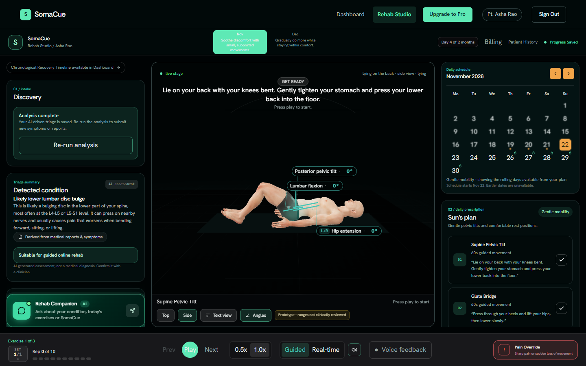
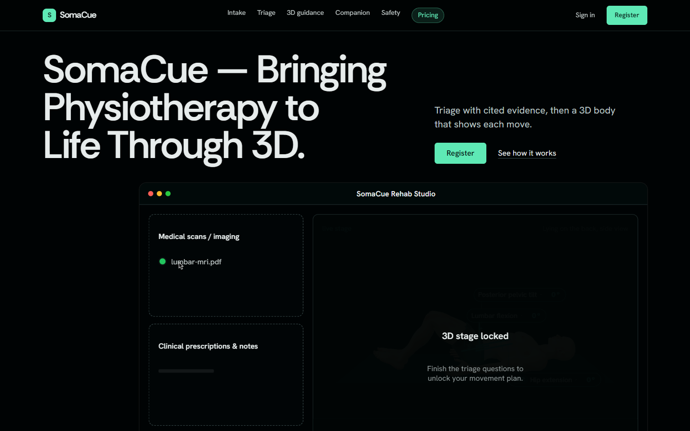
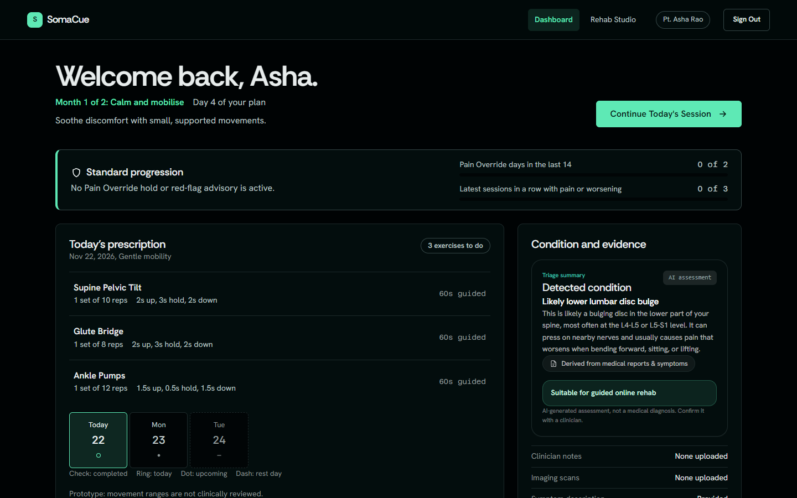
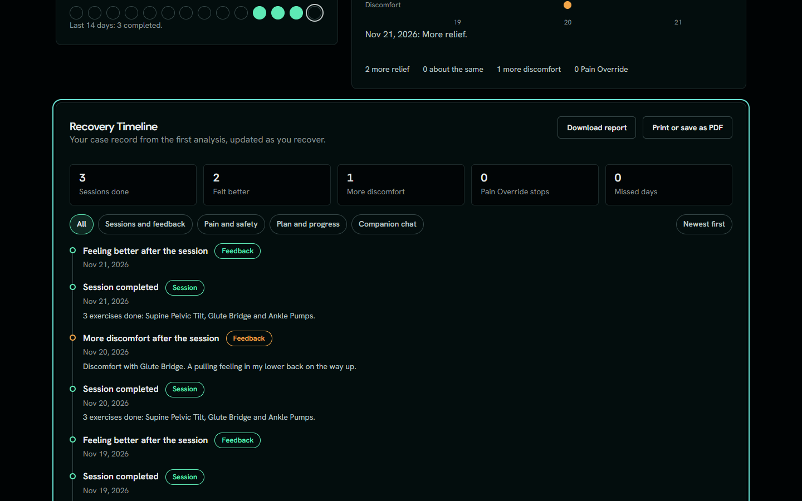

# SomaCue

**AI-assisted home rehabilitation, guided by a 3D body.**

SomaCue turns a patient's scans, clinician notes and symptoms into a cited triage assessment, then into a
multi-month exercise plan that a 3D figure demonstrates move by move. Daily feedback and a one-tap Pain
Override reshape the plan, safety rules lock the platform when a case needs in-person care, and a
chronological Recovery Timeline records the whole journey for sharing with a doctor or physiotherapist.

[](LICENSE)


> **Medical disclaimer.** SomaCue is an educational prototype. It is **not** a medical device, it does not
> diagnose, and it is not a substitute for care from a qualified clinician. AI output can be wrong, and the
> movement ranges are drafts that have **not** been clinically reviewed. In an emergency call your local
> emergency number. See [Safety and disclaimer](#safety-and-disclaimer).



## Contents

- [Features](#features)
- [Screenshots](#screenshots)
- [Tech stack](#tech-stack)
- [Monorepo layout](#monorepo-layout)
- [Routes](#routes)
- [Getting started](#getting-started)
- [Environment variables](#environment-variables)
- [Quality gates](#quality-gates)
- [3D assets and licences](#3d-assets-and-licences)
- [Safety and disclaimer](#safety-and-disclaimer)
- [Known limits](#known-limits)
- [License](#license)

## Features

**Triage and planning**

- **Google-only sign-in.** OAuth 2.0 with PKCE and an HS256 session cookie. There are no passwords to store.
- **Evidence-based intake.** Separate upload areas for scans (MRI, X-ray, CT) and clinician notes, plus a
  symptom description with voice dictation. Files go to Azure Blob Storage, or to local storage when Azure
  is not configured.
- **Cited triage.** The detected condition names what it was derived from (reports and scans, scans and
  symptoms, or symptoms only) and carries an AI safety verdict.
- **Adaptive cross-questioning.** Six to twelve tailored questions, screened for warning signs before any
  plan exists.
- **A plan of one to twelve months.** One phase per month, three baseline exercises and a rolling daily
  schedule, repaired by deterministic code before it is saved.

**3D guidance**

- **Real-time 3D stage.** A rigged body (React Three Fiber) performs each exercise with live joint angles,
  guided and real-time modes, voice cues, top and side views, and a text view.
- **A kinematics engine in plain TypeScript** (`apps/web/lib/kinematics`). Movement specs are clamped to a
  joint-range table, solved on the real skeleton, and replaced by one of 18 reference exercises when the AI
  proposes something that fails validation.

**Safety**

- **Layered guardrails.** Deterministic red-flag screening of intake, quiz answers and chat; an AI safety
  verdict; a full-platform lockout for in-person care; and progress-based escalation after repeated pain.
- **Pain Override.** Stops the session, records where and what happened, rebuilds the plan around it and
  removes later exercises that load the reported region. It is free on every plan.
- **Precautions card.** Permanent, condition-level precautions plus dynamic ones that follow the current
  week, recent feedback, Pain Override reports and missed days. They are rebuilt by rules, with no extra AI call.

**Recovery journey**

- **Daily feedback.** *More relief*, *About the same* or *More discomfort*. Discomfort makes the AI rewrite
  the days ahead around the exercises you name.
- **Recovery Timeline (patient case record).** A chronological record from the first analysis: plan changes,
  weekly progress, missed days, sessions, feedback, Pain Override reports, precaution changes and clinically
  useful updates from the chat. Existing accounts get a full timeline from their stored history.
- **Shareable export.** Download or print a clean report any time (overview, condition summary, milestones,
  pain and feedback trends, current precautions).
- **Rehab Companion.** A chat assistant scoped to the patient's own condition and plan. Off-topic and
  prompt-injection messages are refused without an AI call, and warning-sign messages get a safety reply.
- **Dashboard.** Today's prescription, week view, adherence, feedback trend, records and triage history.

**Billing**

- **Free and Pro.** Free covers one analysis, schedule Days 1 to 7 and a small Companion allowance. Pro is a
  one-time payment for 30, 60 or 90 days (₹199, ₹299 or ₹349) through Razorpay, with server-side limits,
  expiry banners and a webhook that makes payment handling idempotent.

## Screenshots

| Landing | Dashboard |
| --- | --- |
|  |  |



## Tech stack

| Area | Choice |
| --- | --- |
| App | Next.js 16 (App Router, Turbopack, server actions), React 19, TypeScript 5.9 |
| 3D | three.js r187, React Three Fiber 9, drei, three-stdlib |
| Styling | Tailwind CSS 4 and CSS modules over a shared design-token file |
| Database | PostgreSQL with Prisma 7 (`@prisma/adapter-pg`), tested against Neon |
| AI | Vercel AI SDK with any OpenAI-compatible provider, configured only by `AI_BASE_URL`, `AI_API_KEY`, `AI_MODEL` |
| Auth | Google OAuth 2.0 + PKCE, sessions signed with `jose` |
| Payments | Razorpay (one-time, fixed-term Pro tiers) |
| Storage | Azure Blob Storage, with a local fallback for development |
| Tests | Vitest 5, Testing Library, jsdom |
| Tooling | pnpm 12 workspaces, ESLint 9 |

## Monorepo layout

```text
.
├── apps/
│   └── web/                  Next.js application (@somacue/web)
│       ├── app/              routes, API routes, layouts, design tokens
│       ├── actions/          server actions: intake, daily progress, Pain Override, precautions
│       ├── components/       auth, billing, dashboard, intake, landing, stage (3D), workspace
│       ├── hooks/            browser hooks such as voice dictation
│       ├── lib/              domain logic (see below)
│       ├── public/           3D assets, fallback stills, licence notices
│       └── __tests__/        unit and integration tests
├── prisma/                   schema and SQL migrations
├── scripts/                  asset builders and the Razorpay plan setup
├── docs/                     3D engine notes, asset registers, screenshots
├── .env.example              every environment variable, with placeholders
├── LICENSE
├── package.json              root scripts
└── pnpm-workspace.yaml
```

`apps/web/lib` is where the product logic lives:

| Folder | What it holds |
| --- | --- |
| `ai/`, `analysis/` | AI client configuration and the personalised analysis progress copy |
| `clinical/` | Red-flag screening, escalation rules and chat guardrails |
| `kinematics/` | Joint table, movement spec, solver, plan repair, 18 reference exercises |
| `progress/`, `precautions/`, `recovery/` | Schedule reconciliation, dynamic precautions, the Recovery Timeline and its export |
| `billing/` | Plan limits, entitlements and Razorpay integration |
| `auth/`, `db/`, `intake/`, `safety/` | Sessions and Google sign-in, the Prisma client, uploads, safety copy |

## Routes

| Route | Access | Purpose |
| --- | --- | --- |
| `/` | Public | Landing page |
| `/login`, `/register` | Public | Continue with Google |
| `/pricing`, `/terms`, `/privacy`, `/refunds`, `/contact` | Public | Pricing and policy pages |
| `/workspace` | Signed in | Rehab Studio: intake, triage, the 3D stage, schedule, feedback, Companion |
| `/dashboard` | Signed in | Overview, records, history and the Recovery Timeline |
| `/3d-lab` | Public, `noindex` | Experimental anatomy and motion compatibility lab |
| `/api/chat` | Signed in | Rehab Companion (stream, history, clear) |
| `/api/upload` | Signed in | Patient file upload |
| `/api/recovery/export` | Signed in | Printable Recovery Timeline report |
| `/api/billing/*` | Signed in / webhook | Checkout, verification, status and the Razorpay webhook |
| `/api/auth/*` | Public | Google sign-in start and callback, logout |

## Getting started

### Prerequisites

- Node.js `^20.19`, `^22.12` or `>=24` (see `engines` in `package.json`)
- pnpm 12.16.1 (pinned by `packageManager`; `corepack enable` provides it)
- A PostgreSQL database, for example a free [Neon](https://neon.tech) project
- A Google Cloud OAuth 2.0 web client
- An OpenAI-compatible AI provider and key (for example OpenRouter)
- Optional: Razorpay test keys for billing, and Azure Blob Storage for uploads

### Install and run

```bash
git clone https://github.com/Abhishek8229/SomaCue.git
cd SomaCue

corepack enable
pnpm install                     # also runs `prisma generate`

cp .env.example apps/web/.env    # then fill in apps/web/.env, see below
pnpm db:deploy                   # apply the SQL migrations to your database

pnpm dev                         # http://localhost:3100
```

In the Google Cloud console, add `http://localhost:3100/api/auth/google/callback` under **Authorized
redirect URIs**. For another origin, set `NEXT_PUBLIC_APP_URL` and register
`${NEXT_PUBLIC_APP_URL}/api/auth/google/callback`.

### Production build

```bash
pnpm build
pnpm start                       # http://localhost:3100
```

A production start refuses to run without a `SESSION_SECRET` of at least 32 characters.

### Billing (optional)

1. Put your Razorpay **test** keys in `apps/web/.env`.
2. Run `node scripts/setup-razorpay-plan.mjs` to create the 1 month plan and write `RAZORPAY_PRO_PLAN_ID`.
   The 2 and 3 month plans are found or created automatically on first purchase.
3. In the Razorpay dashboard, point a webhook at `${NEXT_PUBLIC_APP_URL}/api/billing/webhook` and enable the
   `subscription.*` events listed in `.env.example`.

## Environment variables

Copy [`.env.example`](.env.example) to `apps/web/.env`. The file documents every variable. Prisma, Next.js
and the scripts all read that one file, and `.gitignore` keeps it out of Git.

| Group | Variables |
| --- | --- |
| Database | `DATABASE_URL` |
| Sessions | `SESSION_SECRET`, `NEXT_PUBLIC_APP_URL` |
| Google sign-in | `GOOGLE_CLIENT_ID`, `GOOGLE_CLIENT_SECRET` |
| AI (all three required) | `AI_BASE_URL`, `AI_API_KEY`, `AI_MODEL` |
| Uploads (optional) | `AZURE_STORAGE_CONNECTION_STRING`, `AZURE_STORAGE_CONTAINER_NAME`, `ALLOW_LOCAL_UPLOAD_FALLBACK` |
| Razorpay | `RAZORPAY_KEY_ID`, `NEXT_PUBLIC_RAZORPAY_KEY_ID`, `RAZORPAY_KEY_SECRET`, `RAZORPAY_WEBHOOK_SECRET`, `RAZORPAY_PRO_PLAN_ID`, `RAZORPAY_PRO_PLAN_2M_ID`, `RAZORPAY_PRO_PLAN_3M_ID` |
| Public business details | `NEXT_PUBLIC_BUSINESS_LEGAL_NAME`, `NEXT_PUBLIC_SUPPORT_EMAIL`, `NEXT_PUBLIC_SUPPORT_PHONE`, `NEXT_PUBLIC_BUSINESS_ADDRESS`, `NEXT_PUBLIC_EMERGENCY_NUMBER` |

The code names no AI model. Whatever `AI_MODEL` holds is what every AI feature uses.

## Quality gates

Run these from the repository root before opening a pull request:

```bash
pnpm typecheck        # tsc --noEmit
pnpm lint             # eslint
pnpm test             # Vitest unit and integration suite
pnpm build            # production build
```

| Extra command | What it does |
| --- | --- |
| `pnpm verify:motion` | Solves every reference exercise on the real rig and checks slip, self-overlap and floor contact |
| `pnpm db:migrate` | Create and apply a new migration in development (`prisma migrate dev`) |
| `pnpm db:deploy` | Apply existing migrations (`prisma migrate deploy`) |
| `pnpm build:body <export dir>` | Rebuild the athlete body from a Character Creator 4 export with `scripts/athlete-male/build.cjs` (run `npm install` in that folder first; see [`docs/3d-engine`](docs/3d-engine/asset-register.md)) |

The tests cover the guardrails and escalation rules, plan repair and the kinematics engine, billing limits
and webhooks, the Companion route, the precautions rules, the Recovery Timeline and its export, and the main
UI components.

## 3D assets and licences

The MIT [LICENSE](LICENSE) covers the **source code** only. Every model keeps the licence of its source:

| Asset | Used for | Source | Licence |
| --- | --- | --- | --- |
| `public/models/athlete-male.glb` and `athlete-male-lite.glb` | The body on the workspace stage | Character Creator 4 export of a Reallusion realistic human base mesh | **Not verified**, see below |
| `public/assets/lab/human-atlas/` | Anatomy in `/3d-lab` | BodyParts3D (DBCLS), the Human Reference Atlas female organ set, and lower-limb muscle geometry from Andreassen et al. (2023) | CC BY 4.0, attribution in `ATTRIBUTION.md` there |
| `public/assets/lab/innerscene/` | Rig in `/3d-lab` | Innerscene Corp, adapted from MakeHuman assets | CC0 |
| `public/assets/lab/mesh2motion/` | Jumping-jacks clip in `/3d-lab` | Mesh2Motion | CC0 |

> **Check this before you fork, deploy or redistribute.** The terms of the Character Creator pack behind
> `athlete-male.glb` could not be confirmed when it was added, so it may not be redistributable. It is the
> body the workspace stage loads. Confirm the licence, or swap in a body you have the rights to: the bone
> mapping is in `apps/web/lib/kinematics/rig.ts`, and the build steps are in
> [`docs/3d-engine/asset-register.md`](docs/3d-engine/asset-register.md).

Full details, hashes and rejected candidates are in the asset registers under `docs/`.

## Safety and disclaimer

SomaCue is an educational and research prototype.

- It does not diagnose. Every assessment is labelled *AI-generated, not a medical diagnosis*.
- Joint ranges and exercise tempos are drafts (`CLINICAL_RANGES_REVIEWED = false`) and have not been
  reviewed by a clinician. The stage is badged accordingly.
- Warning-sign screening is rule-based and cannot catch everything. A case the app flags needs an in-person
  evaluation, and the app then locks guided exercises.
- SomaCue is not an emergency service and cannot contact anyone for you. For sudden severe pain, chest pain,
  numbness in the groin, or loss of bladder or bowel control, get urgent medical care now.
- No compliance work (HIPAA, GDPR, CE or FDA, SOC 2) has been done. Do not use SomaCue with real patients
  without clinical, legal and security review.
- The urgent-care wording is marked as draft and needs clinical and legal review before any public rollout.

## Known limits

- An AI-proposed movement that fails validation is replaced by one of 18 hand-checked reference exercises, or shown as text only. The stage is not a general motion generator.
- The Recovery Timeline report is an HTML document you print or save as a PDF from the browser.
- Dates on the dashboard and in the export follow the server clock, apart from the export, which uses your
  browser's time zone offset.
- `/3d-lab` is an experiment and is not linked from the product.

## License

[MIT](LICENSE) © 2026 Abhishek Tiwari. Third-party models keep their own licences, as listed above.
